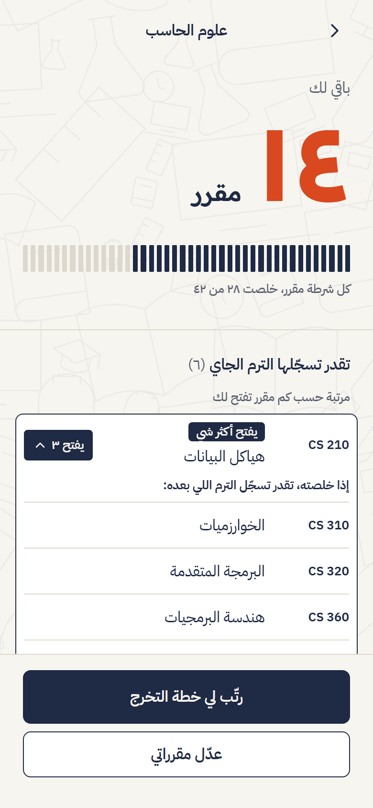
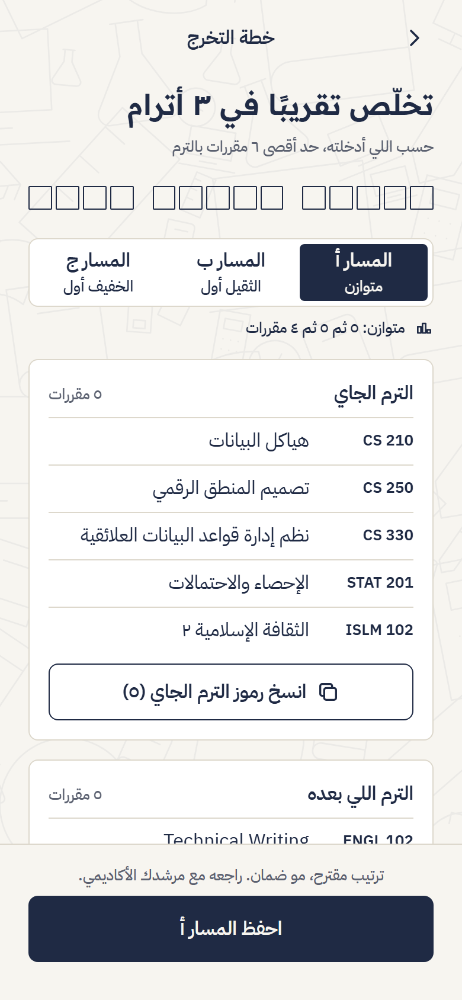
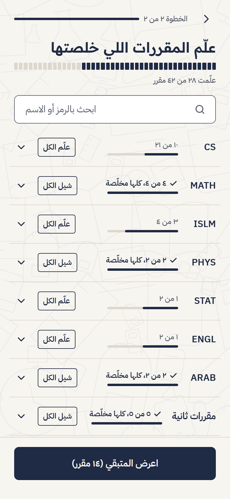

# أرشدني (Arshadni)

يوريك المقررات اللي باقية عليك قبل التخرج، ويقترح لك ترتيب تاخذها فيه. للطالب الجامعي ليلة التسجيل، من جواله.

**جرّبه:** https://arshadni.vercel.app

<p align="center">
  
  
  
</p>

## المشكلة

قبل كل تسجيل يدوّر الطالب على المقررات اللي باقية عليه في موقع جامعة بطيء، مقرر مقرر. وحتى لو عرفها، ما يعرف بأي ترتيب ياخذها عشان يتخرج في وقته.

## وش يسوي الحين

- تختار جامعتك وتدخل مقررات خطتك بنفسك (الرمز، الاسم، متطلب سابق)، أو تجرّب ببيانات تجريبية.
- ترفق سجلك الأكاديمي (PDF) ويعلّم لك المقررات اللي نجحت فيها. القراءة كلها على جهازك بـ pdf.js، والملف ما يطلع منه.
- تعلّم اللي خلصته، والمقررات مجمّعة حسب الرمز (CS، MATH…) مع «علّم الكل».
- تشوف كم مقرر باقي لك، واللي تقدر تسجّله الترم الجاي مرتّب حسب كم مقرر يفتح لك.
- يكشف المتطلبات اللي تدور على بعض (مثلًا A يحتاج B و B يحتاج A).
- يقترح ٣ مسارات للتخرج (متوازن، الثقيل أول، الخفيف أول) بحد أقصى ٦ مقررات بالترم. ترتيب مقترح، مو أقصر طريق مضمون.
- تنسخ رموز الترم الجاي وتحفظ المسار اللي اخترته.
- كل شي ينحفظ في جهازك (localStorage)، بدون حساب ولا سيرفر. يشتغل على الجوال والكمبيوتر.

## وش بعده

- أكثر من متطلب سابق للمقرر الواحد.
- تجربة قراءة السجل على سجلات حقيقية من جامعات أكثر.
- واجهة بالإنجليزي.
- حساب يحفظ خطتك بين أجهزتك.
- اختبارات آلية للمنطق (Vitest).

## مبني بـ

- **JavaScript + React 19**: الواجهة.
- **Vite 8**: التشغيل والبناء.
- **CSS عادي**: كل الألوان والمقاسات من `web/src/tokens.css`.
- **pdfjs-dist**: قراءة السجل الأكاديمي داخل المتصفح.
- **localStorage**: الحفظ على الجهاز.
- **Vercel**: النشر.

## شغّله عندك

تحتاج Node.js 22.13 أو أحدث. ما فيه أي environment variables، ولا تحتاج ملف `.env`.

```bash
git clone https://github.com/Gauk-GH/Arshadni.git
cd Arshadni/web
npm install
npm run dev
```

- `npm run phone`: نفس `dev` بس تفتحه من جوالك على نفس الـ Wi-Fi.
- `npm run build` ثم `npm run preview`: نسخة الإنتاج.

---

انبنى خلال ٥ أيام في Bithra bootcamp.
